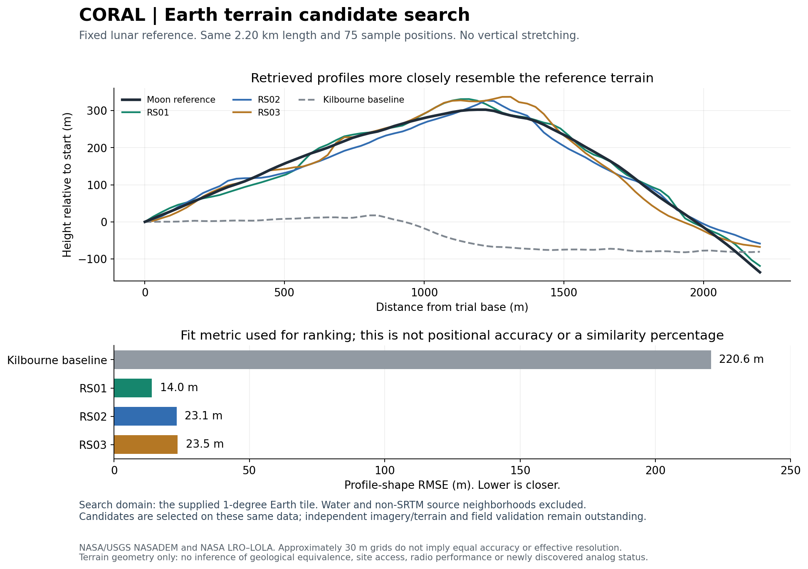

# CORAL

**Earth terrain analogs for lunar communication experiments.**

[Launch the live demo](https://josebit408.github.io/CORAL/) · [Setup and reproduction](SETUP.md) · [Methods](METHODS.md) · [Data sources](DATA_SOURCES.md)

Research prototype developed for the 2026 NASA International Space Apps Challenge: *Identify Earth Locations that Analog the Permanent Moon Base Locations and Mars*.



## Try the demo

Open **[the live demo](https://josebit408.github.io/CORAL/)**. No installation or sign-in is needed. For offline use, download and extract the repository, then open `docs/index.html` in a browser.

The demo compares RS01, RS02, RS03, and the Kilbourne baseline with a fixed lunar reference. Select 5, 10, or 20 m intermediate relay masts and inspect the terrain profiles. Base and rover antennas remain at 2 m. The source links require internet; the demo calculations run in your browser. The candidate table shows nominal fit and tested nearby-shift ranges. A clearance panel reports the weakest checked interior-sample clearance and links with no interior samples. Export calculation summaries as JSON using the demo button.

## Development status

CORAL is an exploratory research prototype for the Moon portion of the challenge. The included candidate results, GIS layers and browser demo are complete for this version. Independent elevation validation and field testing remain future work.

## Problem and approach

Mission teams can use terrestrial analog environments to test equipment and methods. CORAL explores a focused operational analogy: terrain that obstructs a direct base-to-rover line of sight.

1. Fix an illustrative 2,202.181 m lunar corridor in the NASA Site04 Shackleton rim elevation surface.
2. Average complete 6 × 6 blocks of the 5 m lunar surface to a 30 m grid.
3. Screen source and water masks for NASADEM tile n31w107; reproject to a 30 m UTM zone 13N grid.
4. Search Earth start positions and headings using 75 equally spaced profile samples. Rank by root mean squared difference of start-relative elevations, without vertical scaling or distance warping.
5. Compare three spatially separated candidates with a Kilbourne Hole baseline.
6. Explore forward relay links over the sampled terrain, including approximate spherical curvature.

## Results

| Corridor | Profile mismatch (RMSE, m) |
| --- | ---: |
| RS01 | 13.98 |
| RS02 | 23.08 |
| RS03 | 23.47 |
| Kilbourne baseline | 220.59 |

Lower RMSE means closer sampled terrain shape. It is not elevation accuracy, a similarity percentage, or a probability of mission success. Candidates were selected and scored using the same DEM.

| Intermediate mast height | Earth RS01 relay count | Lunar reference relay count |
| --- | ---: | ---: |
| 5 m | 7 | 7 |
| 10 m | 6 | 5 |
| 20 m | 4 | 4 |

Counts are minimum intermediate relays among 75 allowed positions, with forward links along the corridor. They do not establish real-world radio connectivity. RS01 midpoint: 31.020897° N, 106.542984° W, in the Sierra La Candelaria area of Chihuahua, Mexico. Precise geological units and site access remain unverified.

## Repository contents

| Location | Contents |
| --- | --- |
| `docs/index.html` | Self-contained interactive demo; GitHub Pages entry point |
| `src/` | Python search, preprocessing, and figure scripts |
| `tests/` | Numeric, input-validation, and compatibility checks |
| `results/` | Calculated profiles, metrics, and GIS candidate layers |
| `figures/` | Generated scientific figures |
| `data/reference_moon/` | Derived lunar grid, uncertainty grid, and fixed-reference results |
| `data/inputs/` | Kilbourne baseline geometry and available profile samples |
| `METHODS.md` | Assumptions, checks, and remaining validation |
| `DATA_SOURCES.md` | Data provenance and source acquisition |
| `SETUP.md` | Local use, reproduction, and GitHub upload instructions |
| `environment.yml` | Conda environment specification for the analysis tools |
| `requirements-test.txt` | Minimal Python dependency for numerical tests |
| `.github/workflows/tests.yml` | Automated numerical and demo checks on GitHub |
| `CHANGELOG.md` | Changes to the packaged project |

## Run the checks

Python 3.10 or newer and NumPy are sufficient for the numerical tests. Install Node.js to include the browser-demo calculation checks.

```bash
python -m pip install -r requirements-test.txt
python -m unittest discover -s tests -v
```

Full raster processing also needs GDAL. See [SETUP.md](SETUP.md) for the analysis environment and commands. The demo embeds the published profiles and does not automatically update when analysis scripts run.

## Scientific limits

This is an exploratory terrain-obstruction analog, with search coverage limited to one Earth tile and a few lunar trial lines. It is not a globally optimal site search or a verified discovery of a previously unknown analog.

The relay model omits Fresnel clearance, link budgets, diffraction, vegetation, buildings, and field measurements. DEM uncertainty is not propagated into the relay counts. Matching relay counts alone do not establish equivalent communication difficulty. Lines represent antenna links, not rover routes. Nearby line shifts and mast-height trials are sensitivity checks, not independent validation.

## Next development

- Validate frozen candidate corridors against a suitably independent elevation source.
- Characterize terrain, geology, land cover, and site-access limitations with cited evidence.
- Independently verify the candidates before expanding search coverage.
- Add explicit elevation-error scenarios to the sampled-clearance calculations.

## Credits and license

Project author: Jose Zaragoza. Developed with AI-assisted coding, analysis, and documentation; independent scientific and field validation remains outstanding.

Software and original documentation: [MIT License](LICENSE). NASA and other third-party source datasets remain subject to their providers' notices; the software license does not relicense those datasets. See [DATA_SOURCES.md](DATA_SOURCES.md).
